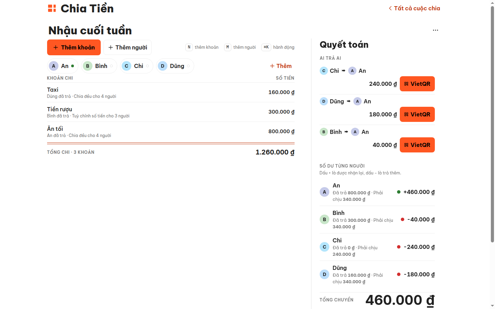
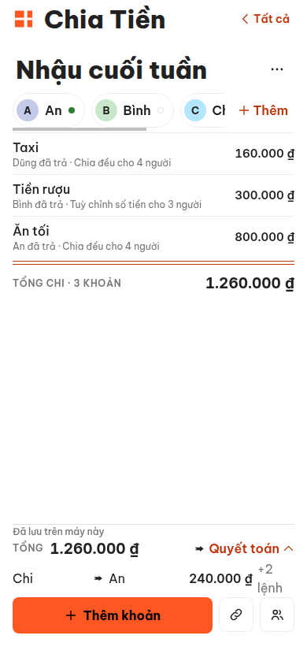
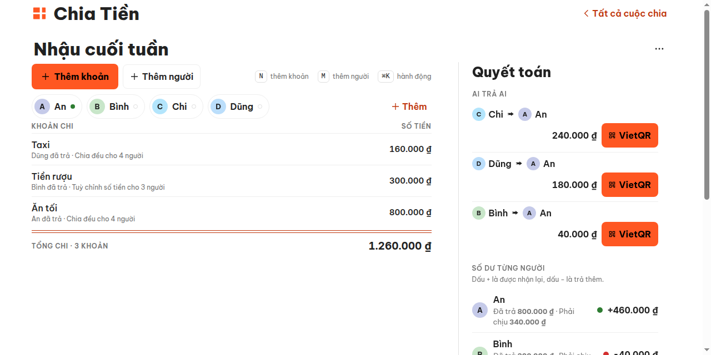
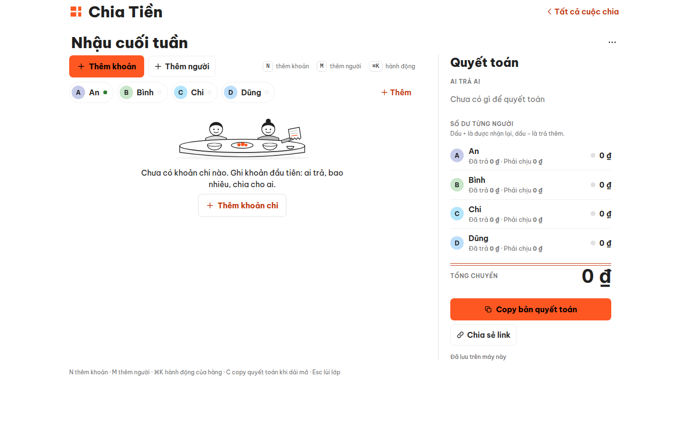
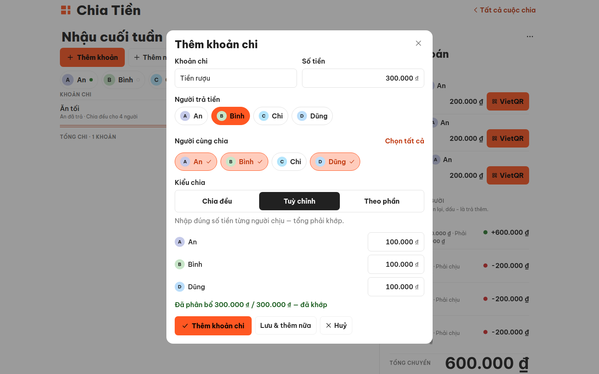
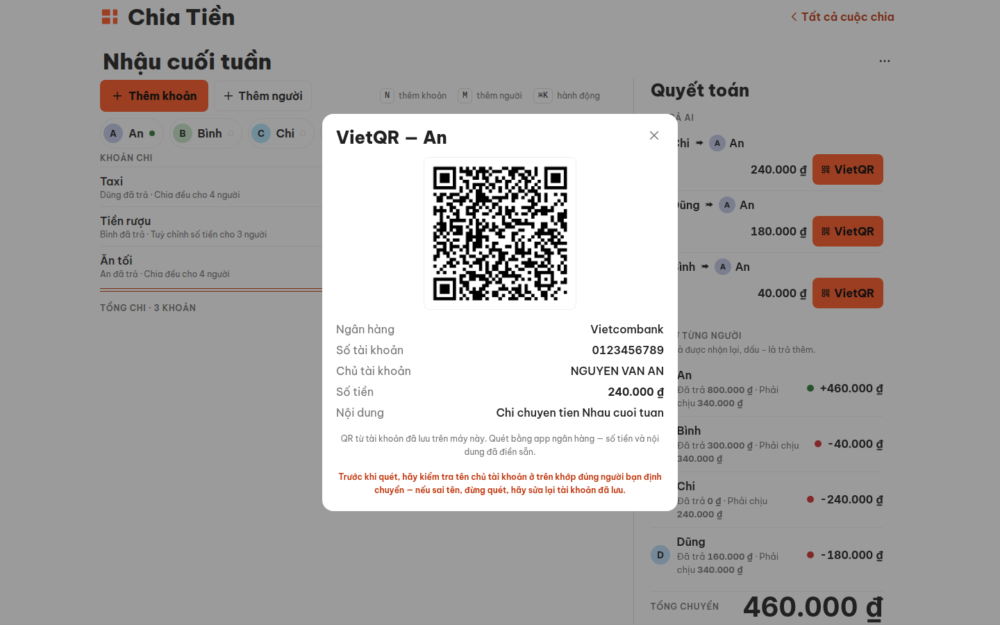

<p align="center">
  
</p>

# Chia Tiền (chiatien)

> Chia tiền nhóm, quyết toán một lần cho xong — kèm VietQR đúng số tiền cho từng lần chuyển.
>
> Đi ăn, đi chơi nhóm: ghi ai đã trả khoản nào, app tự tính ai chuyển cho ai bao nhiêu, ít lần chuyển nhất.

[](https://chiatien-five.vercel.app)
[](LICENSE)

**🔴 Live app: https://chiatien-five.vercel.app** — không cần đăng nhập, không cài app, mở link là dùng ngay trên trình duyệt.
Repository: https://github.com/changvn2002/chiatien

<p align="center">
  
</p>
<p align="center"><em>Một cuộc chia đã chốt xong trên không gian làm việc: 4 người, 3 khoản chi, tổng 1.260.000 ₫ — sổ trực tiếp hiện số dư từng người, cột quyết toán bên phải rút gọn thành đúng 3 lần chuyển (Chi → An 240.000 ₫, Dũng → An 180.000 ₫, Bình → An 40.000 ₫). Các lần chuyển tới An có VietQR vì tài khoản của An đã lưu trên chính máy này. Ảnh chụp thật từ bản production v1.7.2 đang chạy.</em></p>

**Tóm tắt:** Đi chơi chung, ăn nhậu, ở trọ chung… rồi đến màn "để tính sau" là hay
cãi nhau. **Chia Tiền** ghi lại ai đã trả khoản nào, tự chia cho nhóm, triệt tiêu nợ
chồng chéo và cho ra danh sách **ai trả ai bao nhiêu với số lần chuyển tiền ít nhất** —
kèm mã **VietQR** sẵn cho từng lần chuyển khi máy đang dùng đã lưu tài khoản của
người nhận. Không có máy chủ chứa dữ liệu của bạn: mọi thứ nằm ngay trong trình
duyệt của bạn; cần gửi cho cả nhóm thì bấm một nút lấy link chia sẻ chứa thành
viên, khoản chi và kết quả quyết toán — **link không chứa thông tin ngân hàng**
(xem mục "Ngân hàng và link chia sẻ" bên dưới).

## ✨ Tính năng

- **Nhiều cuộc chia độc lập** — mỗi chuyến đi / bữa tiệc / kỳ trọ là một cuộc
  chia riêng: đặt tên, sửa, xoá (có xác nhận và hoàn tác), lưu tự động trên máy.
- **3 kiểu chia** cho từng khoản chi:
  - *Chia đều* cho nhóm người được chọn (xử lý lẻ đồng chính xác tuyệt đối).
  - *Tuỳ chỉnh số tiền* từng người (ví dụ người không uống rượu không chịu tiền rượu) —
    form chỉ cho lưu khi tổng các phần đúng bằng số tiền của khoản chi.
  - *Theo phần/trọng số* (ở 2/3 đêm, ăn 1/2 bữa…).
- **Chỉ chia cho một nhóm nhỏ** — khoản chi nào thì chọn đúng những người liên quan.
- **Quyết toán tối thiểu giao dịch** — thuật toán đơn giản hoá nợ ghép chủ nợ
  lớn nhất với con nợ lớn nhất: n người chỉ cần tối đa n−1 lần chuyển.
- **VietQR thật cho từng giao dịch** — mã QR được dựng 100% ngay trên máy
  (payload EMVCo + vẽ QR tại client, không qua dịch vụ ảnh QR nào). Điều kiện:
  tài khoản của người nhận phải **đã lưu trên chính máy đang xem** (xem mục
  ngân hàng bên dưới) — máy chưa lưu thì app hiện rõ trạng thái "Chưa có mã
  QR trên máy này" và hai cách đi tiếp.
- **Copy bản quyết toán** dạng text, dán thẳng vào Zalo/Messenger cho cả nhóm.
- **Link chia sẻ chứa thành viên + khoản chi + kết quả ai nợ ai** (nén
  lz-string trong phần fragment của URL) — gửi link là người nhận mở ra
  xem/sửa tiếp được, không cần tài khoản hay máy chủ trung gian. Trước khi
  copy, app hiện preview số liệu của cuộc chia (số thành viên, số khoản,
  tổng tiền) và nói rõ link **không thu hồi được sau khi đã gửi**.
- **Tiền VND chuẩn Việt Nam** — gõ `150000` hiển thị `150.000 ₫`, mọi phép tính
  là số nguyên đồng, không bao giờ lệch 1 đồng vì làm tròn.

### Toàn vẹn dữ liệu — không bao giờ lệch tiền trong im lặng

App tiền bạc thì dữ liệu lạ (link bị sửa tay, dữ liệu lưu trên máy bị hỏng) không
được phép tạo ra một bản quyết toán sai mà không ai hay biết. Hai lớp chốt chặn:

- **Lớp làm sạch nghiêm ngặt khi nạp dữ liệu** (`lib/sanitize.ts`, dùng chung cho
  cả link chia sẻ lẫn `localStorage`): mọi số tiền bị ép về số nguyên đồng ≥ 0;
  một khoản chia *tuỳ chỉnh* mà tổng các phần ≠ số tiền của khoản chi sẽ **bị loại
  hẳn** thay vì giữ lại tính tiếp, và app báo rõ số khoản đã bị loại ngay khi mở link.
- **Chốt chặn khi trình bày**: nếu tổng số dư toàn phiên ≠ 0 vì bất kỳ lý do gì,
  khu vực quyết toán hiện cảnh báo đỏ nêu số tiền lệch, và bản quyết toán dạng text
  khi copy cũng chèn dòng cảnh báo — không có đường nào để một quyết toán lệch
  được trình bày như thể đã khớp hết.

### Ngân hàng và link chia sẻ — thiết kế v2

Thông tin ngân hàng **không bao giờ nằm trong link chia sẻ** — đây là quyết
định kiến trúc, không phải lời hứa giao diện (xem
[ADR-002](docs/adr/ADR-002-share-format-v2.md)):

- Payload của link chỉ gồm thành viên (id + tên), khoản chi và dữ liệu suy ra
  được từ đó. Trường ngân hàng bị loại **ngay ở tầng mã hoá link**, và lớp
  giải mã cũng cắt bỏ nếu gặp link bản cũ (v1) còn chứa ngân hàng — người
  nhận được báo rõ việc này.
- Tài khoản ngân hàng của từng thành viên chỉ sống trong **sổ ngân hàng trên
  chính máy của người đó** (`localStorage` của thiết bị đó) — không vào
  link, không vào bản sao cuộc chia trên máy khác.
- Vì vậy VietQR là tính năng **theo thiết bị**: QR chỉ xuất hiện trên máy đã
  lưu tài khoản của người nhận. Đây là đánh đổi có chủ đích để đổi lấy việc
  số tài khoản không bao giờ bị phát tán qua link bị chuyển tiếp.
- Số tài khoản nhập vào được kiểm tra định dạng ngay khi lưu (độ dài và ký
  tự theo đúng dải tài khoản ngân hàng Việt Nam) — số không hợp lệ bị từ
  chối kèm lý do, không lưu, và app không bao giờ hiển thị "có VietQR" cho
  một tài khoản không dùng được.

## 🖼️ Screenshots

Tất cả ảnh dưới đây được chụp trực tiếp từ bản production
[https://chiatien-five.vercel.app](https://chiatien-five.vercel.app) khi app đang ở
trạng thái **đã dùng thật**: cuộc chia "Nhậu cuối tuần" gồm 4 người (An, Bình, Chi,
Dũng), 3 khoản chi và quyết toán hoàn chỉnh — không phải màn hình trống lúc mới mở
app hay ảnh dựng sẵn.

### Quyết toán — giá trị cốt lõi của app


_Trên desktop, cột Quyết toán bên phải: danh sách "Ai trả ai" đã rút gọn — cả
nhóm chỉ cần 3 lần chuyển là xong nợ; các lần chuyển tới An có nút VietQR vì tài
khoản Vietcombank của An đã lưu trên máy này. Dưới là số dư từng người sau 3
khoản chi (An đã trả 800.000 ₫ nên được nhận lại +460.000 ₫; Bình −40.000 ₫,
Chi −240.000 ₫, Dũng −180.000 ₫)._

| Mobile (390×844) | Social / link-preview (1280×640) |
| --- | --- |
|  |  |
| _Trên điện thoại, các khoản chi xếp dọc trong một màn hình làm việc; dải quyết toán ghim ở đáy luôn hiện tổng chi và lệnh chuyển đầu tiên — mở Quyết toán là thấy đủ ai nợ ai và quét VietQR cho từng lệnh._ | _Khung 1280×640 dùng cho ảnh xem trước khi gửi link app qua Zalo/Facebook — vẫn thấy 3 khoản chi và đủ 3 lệnh chuyển quyết toán._ |

### Theo từng bước sử dụng

**Thêm cả nhóm ngay trên màn hình cuộc chia.** Ai sẽ nhận tiền qua VietQR thì
lưu tài khoản ngân hàng của người đó ngay trên máy của mình: chip của người đó
có chấm xanh nghĩa là đã lưu ngân hàng trên máy này, vòng rỗng là chưa lưu —
**không hiện số tài khoản**; số tài khoản đầy đủ chỉ xuất hiện trong sheet
thanh toán của đúng lần chuyển liên quan.



**Ghi từng khoản chi, chọn đúng người cùng chia.** Khoản "Tiền rượu"
300.000 ₫ do Bình trả, chia *tuỳ chỉnh số tiền*: chỉ 3 người uống (An, Bình, Dũng)
mỗi người 100.000 ₫, Chi không uống nên không phải chịu. App cộng tổng ngay trên
form và chỉ cho lưu khi "đã phân bổ 300.000 ₫ / 300.000 ₫ — đã khớp".



**Chốt quyết toán và quét VietQR trả ngay.** Bấm nút VietQR ở lần chuyển
Chi → An 240.000 ₫: mã QR hiện ra với đúng số tiền và nội dung chuyển khoản đã
điền sẵn, kèm ngân hàng/số tài khoản/tên chủ tài khoản để đối chiếu — app nhắc
kiểm tra tên chủ tài khoản khớp đúng người nhận trước khi quét.



## 🧭 Cách hoạt động

1. **Tạo cuộc chia**, thêm từng thành viên (ai nhận tiền qua VietQR thì lưu thêm tài khoản ngân hàng của họ — trên máy của chính họ, hoặc trên máy của bạn nếu họ đồng ý).
2. **Ghi từng khoản chi**: ai trả, bao nhiêu, chia cho những ai — chia đều, tuỳ chỉnh số tiền, hoặc theo phần.
3. **Chốt quyết toán**: app tính số dư từng người và rút gọn thành ít lần chuyển nhất. Quét VietQR để trả ngay (trên máy đã lưu tài khoản người nhận), hoặc copy bản quyết toán gửi thẳng vào nhóm Zalo/Messenger.

## 🏗️ Kiến trúc

Chia Tiền là ứng dụng **hoàn toàn client-side**: không API, không database,
không tài khoản — logic thuần trong `lib/` (chia tiền, quyết toán, VietQR,
làm sạch dữ liệu), giao diện trong `components/`, dữ liệu qua một adapter
`localStorage` duy nhất. Tài liệu đầy đủ: [docs/ARCHITECTURE.md](docs/ARCHITECTURE.md)

- [Sơ đồ module và ranh giới phụ thuộc](docs/ARCHITECTURE.md#2-module-map)
- [Luồng dữ liệu: nạp → sửa → đồng bộ xuyên tab → chia sẻ → thanh toán](docs/ARCHITECTURE.md#3-data-flow)
- [Lưu trữ & phiên bản dữ liệu (schemaVersion, share payload v2)](docs/ARCHITECTURE.md#4-data-storage--versioning)
- [Các quyết định kiến trúc (ADR)](docs/ARCHITECTURE.md#7-decisions-adr)

## 🛠️ Công nghệ

- Next.js 16 + React 19 + Tailwind CSS 4, static prerender, hoàn toàn client-side.
- Logic thuần tách riêng trong `lib/` (`split`, `settle`, `vietqr`, `share`,
  `sanitize`, `storage`, `money`) và được kiểm chứng bằng **Vitest** — gồm
  property test cho thuật toán quyết toán (sau quyết toán mọi số dư về 0, số
  giao dịch ≤ n−1, tổng luôn cân bằng), fuzz test cho đường share link, và
  component test cho lớp che số tài khoản (số TK chỉ xuất hiện trong sheet
  thanh toán). Toàn bộ chạy trên CI cùng typecheck/lint/format/build, quét
  bí mật (gitleaks) và kiểm ngân sách JS.
- SEO/PWA đầy đủ: metadata + Open Graph, JSON-LD, sitemap, robots, web app
  manifest, icon cài lên màn hình chính, service worker để mở lại khi offline.

## 🚀 Chạy local

Tiên quyết: **Node 24** (ghim ở `engines` trong `package.json` và `.nvmrc` —
dùng `nvm use` để lấy đúng bản) và **pnpm 10.32.1** (khai ở trường
`packageManager`; bật qua Corepack: `corepack enable`).

```bash
pnpm install --frozen-lockfile
pnpm dev            # http://localhost:3100 — bản phát triển
pnpm test           # Vitest: logic chia/quyết toán + lớp làm sạch + component
pnpm test:coverage  # test kèm coverage (có ngưỡng bắt buộc theo thư mục)
pnpm build          # bản production
pnpm start          # chạy bản production vừa build (port 3100)
```

Biến môi trường duy nhất (tuỳ chọn): `NEXT_PUBLIC_SITE_URL` — URL gốc của bản
production cho SEO; khi không đặt, app dùng `https://chiatien-five.vercel.app`
(khai trong `lib/site.ts`). Xem `.env.example`.

## 🔒 Quyền riêng tư

App không thu thập dữ liệu: mọi cuộc chia lưu trong `localStorage` của chính
trình duyệt bạn đang dùng, và **không có bên thứ ba nào nhận dữ liệu từ app**
— kê khai đầy đủ ở [docs/THIRD-PARTIES.md](docs/THIRD-PARTIES.md) (bên duy
nhất là Vercel với vai trò hosting/CDN cho nội dung tĩnh công khai, kèm bằng
chứng network capture trên production).

Link chia sẻ mang dữ liệu trong phần fragment của URL — phần này không bao
giờ được gửi lên máy chủ khi tải trang. Hãy coi link là một **bản sao của
cuộc chia** (thành viên, khoản chi, kết quả ai nợ ai): ai có link cũng mở
xem và sửa tiếp được bản sao của riêng họ, và **link không thu hồi được sau
khi đã gửi** — chỉ gửi cho người trong nhóm. Thông tin ngân hàng thì **không
nằm trong link** ở bất kỳ trường hợp nào (xem mục "Ngân hàng và link chia
sẻ" ở trên).

## 🤝 Hỗ trợ

Dự án do **chang2tech** duy trì. Cần hỗ trợ hoặc báo lỗi: mở issue tại
[github.com/changvn2002/chiatien/issues](https://github.com/changvn2002/chiatien/issues) —
mô tả rõ thao tác, điều bạn thấy và điều bạn mong đợi; nếu là lỗi liên quan
quyết toán, ghi rõ các khoản chi (không cần gửi thông tin ngân hàng thật).

## 📚 Tham chiếu

- [docs/ARCHITECTURE.md](docs/ARCHITECTURE.md) — kiến trúc, luồng dữ liệu, điểm mở rộng
- [docs/adr/](docs/adr/) — ADR-001 (vì sao localStorage-only), ADR-002 (share format v2)
- [docs/THIRD-PARTIES.md](docs/THIRD-PARTIES.md) — kê khai bên thứ ba & luồng dữ liệu
- [docs/security/EXCEPTION-REGISTRY.md](docs/security/EXCEPTION-REGISTRY.md) — sổ đăng ký ngoại lệ CSP (SEC-02)
- [CHANGELOG.md](CHANGELOG.md) — lịch sử thay đổi theo phiên bản
- [DESIGN.md](DESIGN.md) / [PRODUCT.md](PRODUCT.md) / [BRAND.md](BRAND.md) — ngôn ngữ thiết kế, sản phẩm, thương hiệu

## ⚖️ Vì sao & Giới hạn

**Vì sao làm kiểu này:** bài toán chia tiền nhóm cần dùng ngay — không đăng
nhập, không cài app, không chờ máy chủ — và dữ liệu tiền bạc của một nhóm
bạn bè không có lý do gì phải nằm trên máy chủ của người khác. Kiến trúc
client-only + share link biến mỗi link thành một bản sao độc lập: gửi đi là
xong, không phụ thuộc hạ tầng nào ngoài hosting tĩnh.

**Giới hạn đã biết (nói thẳng):**

- Dữ liệu gắn với **một trình duyệt trên một máy**: xoá dữ liệu trình duyệt
  là mất sổ; muốn mang sang máy khác phải dùng share link (và sổ ngân hàng
  thì phải lưu lại trên máy mới, vì ngân hàng không đi theo link).
- Không đồng bộ thời gian thực giữa nhiều người: mỗi người giữ một bản sao
  khi mở link; hai tab cùng sửa trên một máy được app phát hiện và báo rõ,
  nhưng hai máy khác nhau thì không tự hợp nhất.
- VietQR phụ thuộc sổ ngân hàng của **máy đang xem** (đánh đổi kiến trúc để
  bảo vệ số tài khoản — xem ADR-002).
- Trần nhập liệu một khoản chi là 999.999.999.999 ₫ — thừa cho mọi khoản chi
  nhóm thực tế, và là chốt chặn chống nhập nhầm số 0.

## 📄 Giấy phép

MIT — xem `LICENSE`. © chang2tech.

Logo và artwork thương hiệu **không** nằm trong giấy phép MIT — xem
`NOTICE` và `BRAND.md`; nếu fork, hãy thay bằng thương hiệu của bạn.
